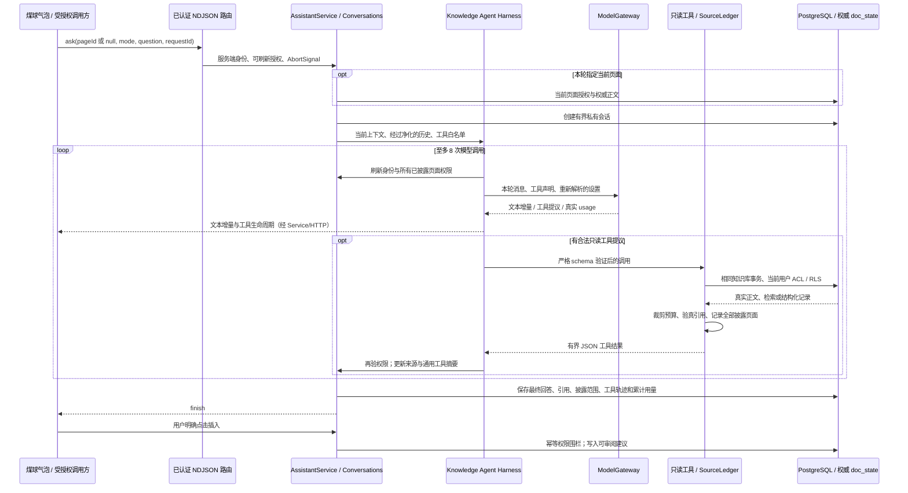

# Fob 知识助手 Agent

本文是知识助手运行内核的当前设计。产品和权限总边界见 [Fob 产品边界](architecture/fob-product-boundaries.md)，编辑器块生成、检索与模型配置的总体说明见 [知识发现](knowledge-discovery.md)。煤球聊天的当前产品设计见 [煤球 AI 对话](companion-ai-chat.md)，执行与验收状态见 [煤球对话任务](../.spec/tasks/companion-ai-chat.md)。

## 接入与使用

全局设置 → AI 接入管理当前知识库的共享模型服务。管理员配置一次，所有成员直接使用；连接与默认模型不按账户划分。每套连接独立配置名称、协议、Base URL、加密密钥和模型清单；支持公网 HTTPS 兼容服务与服务端明确批准的 Ollama 地址。空密钥保留原凭据，切回服务端默认保留知识库连接，删除连接才清理其密钥和默认关联。连接测试使用真实 provider，usage 来自网关实际调用记录，并按知识库汇总所有成员的用量。

AI 接入仅向当前知识库的所有者与管理员开放，其他成员不显示设置菜单及煤球中的配置入口。配置读取与操作由服务端重新校验成员身份和角色；普通成员的 AI 对话能力保持原有授权边界。当前权限、布局、服务切换与响应式设计见 [AI 接入设置](ui/ai-connections.md)。

服务端默认读取 `KNOWLEDGE_AI_API_KEY`、`KNOWLEDGE_AI_CHAT_BASE_URL`、`KNOWLEDGE_AI_MODEL`；本次环境使用 BigModel Coding URL 与 `glm-5.3-flash`。凭据不进入仓库、浏览器状态或日志。知识库凭据使用 AES-GCM，密钥由部署的 Fob 认证 secret 加产品域分离摘要得到；多 API 节点使用一致认证配置，轮换后需重新录入凭据。

现有数据库执行幂等升级：`bun --env-file=.env.fob.local backend/server/scripts/upgrade-assistant.ts`，需使用原 Fob 认证 secret 才能重新加密已有密钥。升级优先采用仍在库中的所有者配置；没有所有者配置时采用管理员配置（优先最近更新，再按加入时间和用户 ID 确定唯一来源），不合并冲突的账户默认模型，也不自动共享普通成员的私有凭据。连接 ID 与默认绑定保留，密钥重新绑定知识库身份加密。旧账户连接及偏好完整迁入仅数据库管理员可访问的 `fob_archive`；旧账户凭据仍保留在原加密存储。升级全程同事务，错误回滚，重复执行不覆盖现有知识库配置。新数据库直接使用当前规范 schema，表拥有组合作用域外键、FORCE RLS 与应用角色授权。

正文 `/` 菜单顶部提供「生成」「创建可视化」；生成内容保留为块内草稿，可停止、提出修改要求、撤销或采纳，采纳后成为普通文档块。可视化输出原生 Mermaid 节点。旧独立聊天弹窗及其文档顶栏和选区入口已按用户要求删除。用户选定煤球 UX 方案 1 后，聊天改由点击全局煤球精灵打开锚定在精灵附近的轻量气泡，作为当前唯一聊天入口。

块菜单宽 360px、行高 32px，沿用 13px 产品控件字号；生成空态高 120px、胶囊输入条高 38px、操作圆钮 30px，正文阅读字号保持原有设置。生成菜单、块、设置和协作光标继续使用集中目录的用户指定五角斜星与右下长尖，固定摘要防止回退到四角 Sparkle；可视化共用官方四形组合。模型选择和协议菜单复用共享 Radix 控件，增长清单支持搜索；没有原生 select。

### 独立窗口撤回与当前煤球入口

独立聊天窗口实现已撤回，包括窗口/位置记忆、对话编排、输入区、历史、回答展示、弹窗设置包装、选区事件桥、专用 React 控制器、样式、文案及其专用测试。编辑器不再挂载助手 Portal，也不再向文档顶栏或选区工具栏提供打开旧窗口的入口。删除的是界面代码，不清空用户已保存的服务器会话或模型连接。

保留 `assistant-api.ts` 的纯鉴权 transport、响应 schema 与流式解析，它们也服务于全局 AI 接入设置；保留模型选择器、错误映射、编辑器流式任务和所有后端知识助手能力。当前煤球对话通过 `src/features/companion/chat/` 的气泡界面、会话控制器和工作区上下文适配复用同一套后端协议与 Agent Harness，不恢复旧窗口代码。

气泡支持流式多轮问答、停止、重试、私有历史、来源跳转和全局 AI 设置入口。当前用户、知识库和可选文档由活动工作区发布，不从页面正文或 URL 文本推测授权。没有当前文档时使用整个知识库范围；本机知识库、未登录、无知识库及错误状态明确显示真实限制。气泡设计、交互和本轮 UI 验收证据统一维护在 [煤球 AI 对话](companion-ai-chat.md) 与对应任务中；此前独立弹窗的视觉和验收记录仅为历史。

### 人设与无当前页对话

模型系统指令使用「煤球，Fob 中陪伴用户的知识伙伴」。日常问候和闲聊自然、友好、简洁地回应；用户没有要求时，不主动介绍或总结当前文档，也不罗列工具过程、检索算法或模型配置。涉及知识库事实时仍需真实资料支持与可验真的引用，不能编造资料、来源或已执行操作。参考正文、历史回答和工具结果继续被当作不可信数据，不能覆盖系统指令和权限边界。

`assistantAsk.pageId` 接受 UUID、显式 `null` 或省略，后两种归一为 `null`，且仅允许 `mode: 'knowledgeBase'`。默认模式和显式文档模式都必须提供有效页面 UUID；缺失页面返回 `invalid_request`，不会静默扩大任务范围。`AssistantTurn.pageId` 同样可空，旧 UUID 请求与已存历史保持兼容。

知识库模式无当前页时，从空来源账本开始按需检索，不创建占位页面、不读取未经授权的首页，空知识库仍可正常日常对话。模式、用户与知识库始终明确传入原服务；可空页面不是绕过身份、知识库成员资格、令牌 scope 或页面 ACL 的条件。

## Pi 源码依据

参考仓库为 [badlogic/pi-mono](https://github.com/badlogic/pi-mono)，本地只读参考目录为 `opensource/pi-mono`。本次浅克隆固定到 `e49b1495045f06643a7cc4c93330fabc2ab37ce4`；来源摘要保存在 `opensource/pi-mono-source.json`。Pi 使用 [MIT License](https://github.com/badlogic/pi-mono/blob/e49b1495045f06643a7cc4c93330fabc2ab37ce4/LICENSE)，版权为 Mario Zechner。Fob 实现是面向知识库的独立代码，没有复制 Pi 的桌面、终端或编码工具运行时，也没有引入其 npm 依赖。

实际阅读并据此分层的源文件：

| Pi 源文件（上述 commit） | 源码职责 | Fob 对应 |
| --- | --- | --- |
| `packages/agent/src/agent-loop.ts` 的 `runLoop`、`streamAssistantResponse` | 模型轮次与工具结果继续循环；在模型调用边界转换消息 | `ai/agent/harness.ts`、`model-adapter.ts` |
| 同文件的 `prepareToolCall`、`executeToolCallsSequential`、`finalizeExecutedToolCall` | 参数验证、调用前后钩子、顺序执行及工具生命周期 | `knowledge-tools.ts` 复用 Zod/ACL handler；harness 的 `check`、`onTool` |
| `packages/agent/src/types.ts` 的 `StreamFn`、`PrepareRequest`、`AgentLoopConfig` | 注入模型流、运行状态与生命周期；执行器不绑定模型供应商 | `types.ts` 的 `AgentModel`、`AgentReadTool`、`AgentRunOptions` |
| `packages/ai/src/models.ts` 的 provider/stream/auth 分层 | 模型 API、认证和请求观测归一 | 继续使用 Fob `ModelGateway`，在每一轮重新解析知识库设置与受控凭据 |
| `packages/ai/src/providers/zai-coding-cn.ts` | 智谱 Coding 的 OpenAI Completions 协议与官方 endpoint | Fob gateway 的受控 endpoint 和 provider 配置 |
| `packages/ai/src/api/openai-completions.ts`、`utils/validation.ts`、`utils/abort.ts` | 工具消息适配、参数校验、流式事件、中断后的 Promise 处理 | Gateway 的 AI SDK 协议边界；严格 Zod 验证；`budget.ts` 的可取消等待 |

Pi 的通用循环提供可扩展的运行时基础。Fob 将这套分层收敛到当前用户、当前知识库和已授权页面：没有 shell、文件系统、任意网络、任意 SQL 或模型自动写入工具。前端不接触 provider secret。

## 模块与请求流



| 模块 | 职责 |
| --- | --- |
| `assistant/context.ts` | 有当前页时授权读取权威正文；知识库无页时建立空上下文和来源账本，按需检索 |
| `agent/harness.ts` | 有界模型/工具循环、消息配对、工具执行顺序、累计 usage、停止和错误边界 |
| `agent/model-adapter.ts` | 将 harness 的模型接口映射到现有 Gateway；每步重新解析知识库设置 |
| `agent/knowledge-tools.ts` | 复用产品/MCP 的只读 schema 与 handler，增加范围收敛、真实关键词降级、输出投影 |
| `agent/sources.ts` | 正文块来源验真/去重，以及独立的模型可见页面账本 |
| `agent/budget.ts` | Unicode 安全的 UTF-8 裁剪、JSON 投影和可取消等待 |
| `agent/prompts.ts` | 任务范围、资料信任边界、引用格式和完整对话对的历史预算 |
| `agent/insertion-receipts.ts` | 与正文同一 Yjs 事务的插入收据；崩溃窗口重试、旧建议归因恢复和有界清理 |
| `assistant/service.ts` | 会话、流事件、15 秒权限心跳/保存、显式插入、取消及错误归一 |
| `assistant/conversations.ts` | 私有会话持久化、跨节点运行配额、物理留存与历史权限净化 |

Harness 不直接依赖数据库、HTTP、密码或协作文档写入。模型适配器只提出调用；只读工具由 harness 授权调度。写入保留独立的 `apply` 产品操作，不能通过模型返回工具名触发。

## 工具与任务范围

文档模式要求有效当前页面，只声明 `read_page`，输入 JSON Schema 的 `pageId` 固定为当前文档，运行时还会再次比较页面 ID。历史只带入同一文档、同一文档模式的已完成回答，避免切回文档模式时继承旧的跨页资料。知识库模式可以没有当前页；旧轮无页不产生虚假披露记录，实际经工具和历史进入模型的页面仍全部记账和复验权限。

知识库模式声明以下工具：

| 工具 | 结果与约束 |
| --- | --- |
| `search` | 已装配 embedding 绑定时复用混合检索；否则实际执行 ACL 过滤的 PostgreSQL BM25，不创建虚假向量结果。返回真实 `searchMode`、`vectorLeg`、`rerank` |
| `read_page` | 从权威 `doc_state` 读 Markdown/块；保留可验真的来源编号；支持指定块范围 |
| `list_pages` | 返回当前用户可见的页面 ID、标题与类型；投影后才进入模型上下文 |
| `query_database` | 复用数据库筛选、排序、分页和行级可见性；返回实际字段名/类型/选项与有界行值，供下一步构造正确查询 |
| `get_backlinks` | 复用来源可见性，且额外排除其他知识库的入链；来源块再经权威引用校验 |

所有工具在执行前使用刚刷新过的服务端 `KnowledgeRequestContext`，不接受模型或客户端自报身份、主体、知识库 ID。不存在、不可见和已回收目标以通用工具错误返回；基础设施和 provider 的原始异常、响应体、密钥不进入模型或 UI。

数据库属性或页面标题可能没有正文块。它们仍计入 `contextPageIds`；不能为此伪造一个块锚点。需要正文引用时继续读取页面，工具给出实际 `sourceId` 后才允许 `[n](fob-source:n)`。最终答案中的未知来源编号会移除链接。

## 多服务商连接与模型绑定

知识库配置使用 `knowledge_base_ai_connection(knowledge_base_id,id)` 保存共享连接，`knowledge_base_ai_settings(knowledge_base_id)` 保存唯一默认设置，`knowledge_base_ai_credential(knowledge_base_id,id)` 保存加密密钥。这三张表均无用户外键，管理员离开或更换后配置仍然有效。每个知识库最多 24 个连接，每连接最多配置 100 个模型；保存、修改、删除与迁移使用同一知识库级 advisory lock。公共 DTO 只返回 `hasCredential`，不返回 API key、密文或 credential ID。AES-256-GCM 的附加认证数据绑定知识库、空账户标记、凭据 ID、provider ID 与 endpoint；更换 Base URL、协议或 key 时重新加密并撤销旧凭据。历史账户凭据格式保持兼容，不允许跨账户读取，也不会作为当前配置的隐式回退。删除一个连接只撤销它自己的 key，并清除全库引用它的默认绑定。

`knowledge_base_ai_settings.settings` 保留现有纯 `ModelSettings`，fast/smart 可以绑定不同连接及模型。`resolveFor(actor, selection?)` 按知识库校验连接归属和模型是否已配置；本轮临时选择只覆盖这一次请求，不修改共享默认绑定。煤球对话和文档生成共用该解析器，Gateway 的调用上下文仍携带实际发起者，以保留用量、页面 ACL 和会话归属。连接或模型缺失、密钥不可用都返回真实配置错误。迁入的旧单服务商设置在服务端事务中转为可见连接，保留 fast/smart 原模型和密钥；旧的、服务器已批准的 Ollama 设置也迁为可见的无 key 连接。

模型协议有三个真实实现，不进行协议伪装：

| 设置协议 | 后端 adapter | 请求路径 |
| --- | --- | --- |
| `openai-compatible` | `@ai-sdk/openai-compatible` 的 chat model | `/chat/completions` |
| `openai-responses` | `@ai-sdk/openai` 的显式 `.responses(modelId)` | `/responses`，禁用供应商侧 response 存储 |
| `anthropic` | `@ai-sdk/anthropic` | `/messages` |

实现依据 [AI SDK v7 OpenAI provider 文档](https://ai-sdk.dev/providers/ai-sdk-providers/openai) 与 [OpenAI Compatible provider 文档](https://ai-sdk.dev/providers/openai-compatible-providers)。`@ai-sdk/openai` 固定为 4.0.77，与现有 `ai@7.0.116` 使用同一 `@ai-sdk/provider@4.0.18`，避免只升级某个 adapter 后产生协议类型漂移。

静态平台配置继续使用服务器的受控 endpoint。知识库连接以 `fob-connection-<uuid>` 作为 provider ID，Gateway 每次调用通过 `resolveProvider(context,providerId)` 按当前知识库解析定义，验证 endpoint、模型清单与凭据；不修改部署级 provider registry，也不临时切换其他知识库的默认模型。连接测试走同一个 Gateway 和用量记录，指定一个已配置模型真实调用，不能用“字段齐全”代替成功连接。

自定义 Base URL 支持公开 HTTPS 地址。保存时验证 URL 语法、保留主机名和字面 IP；每次实际请求前重新解析全部 DNS 结果，任一私网、环回、链路本地、文档/保留或转译地址即拒绝。新的 Node `http(s)` socket 通过自定义 lookup 固定到刚验证的公网 IP，HTTP Host/TLS SNI 保持原 hostname，关闭连接池复用和地址二次选择。用户无法通过环境代理、DNS 重绑或 redirect 把带 key 的请求送入内部网络。HTTP 或私网地址只允许精确匹配服务器预先批准的 Ollama endpoint，网页不能自行扩展这个范围。

`model-discovery.ts` 与存储分离，使用相同受控 transport 请求 `/models`。Anthropic 使用 `x-api-key`/`anthropic-version` 并按本地构造的 `after_id` 分页，不跟随供应商返回的任意 next URL；其他协议使用 Bearer key。结果去重并限制最多 300 个模型、3 页、累计 2 MiB、30 秒，清楚返回 `truncated`。发现清单不自动覆盖已配置模型，用户明确保存后才可用于绑定；认证失败、无模型、格式非法和超限结果分别体现，不能伪报连接成功。

## 预算和生命周期

快速档最多 6 次模型调用、12 次工具、120 秒，每次输出最多 4096 tokens；深度档使用下表的 8 / 16 / 170 秒预算及每次最多 8192 tokens。两个档位可以绑定同一模型，研究预算仍有实际区别。

预算是服务器常量，客户端不能放大：

| 项目 | 当前上限 |
| --- | --- |
| 模型轮次 | 8，最后一次关闭工具用于归纳 |
| 工具提议/执行 | 累计 16；未知、无效及截断提议也消耗名额 |
| 相同工具+参数 | 最多实际执行 2 次，随后返回循环保护错误 |
| 整轮 wall time | 170 秒 |
| 单次模型等待 | 最多 90 秒，仍受整轮 deadline 约束 |
| 单个只读工具 | 20 秒 |
| 回答 | 64,000 个字符 |
| 总模型消息与系统文本 | 192,000 UTF-8 字节 |
| 历史对话 | 最近至多 6 个完整对话对、20,000 UTF-8 字节 |
| 当前文档种子上下文 | 40,000 UTF-8 字节；知识库模式最多 12 个初始引用 |
| 单次工具结果 | 20,000 UTF-8 字节，内部留出 JSON 包装余量 |
| 累计检索/参考资料投影 | 100,000 UTF-8 字节 |
| 正文引用 / 披露页面 | 30 / 100 |

先进行 JSON 投影、字符串/嵌套深度/数组裁剪和预算判断，再记录其页面范围，最后才交给模型。未能记账的第 101 个页面资料不会进入模型。所有被裁剪的资料返回 `truncated`。来源编号在本轮内稳定、去重，且只有 `validateCitations` 对当前权威块给出 `valid` 才登记。

每次模型调用、每个工具前后以及结束前强制刷新授权；文本流阶段最多每 750 毫秒检查一次。独立 15 秒心跳在模型长时间思考时刷新权限并串行保存 partial turn，防止会话运行租约过期。终态保存前停止心跳并等待已排队保存完成，避免旧快照覆盖终态。

取消会终止模型等待和后续工具。未配合信号的只读 Promise 不会卡住请求；异步完成/拒绝仍被观察，已中断的资料不会再登记或交给下一轮。工具超时返回通用错误，模型可根据已有资料解释限制。总 deadline、权限变化和凭据失效终止整个循环。凭据/页面权限失效会清空答案、问题、来源及工具轨迹；普通用户取消则保留此前已有权限的 partial answer。

仅在尚无文本、工具提议或可见结果时，provider 的可重试限流/暂时故障允许重试一次。产生部分输出后的失败、工具调用和正文写入均不会自动重放。输出 token 截断的工具参数一律不执行。

## 持久化、权限与并发

会话延续使用 `ai_task(kind=chat, state.assistantVersion=1)`，不写 provider 内部 transcript 或工具原始结果。持久化用户问题、答案、可空的当前页、模式、可用来源、全部 `contextPageIds`、最多 16 条实际工具步骤及累计 usage。当前页保存在 turn JSON 中，表没有聊天专用 `page_id` 列，本次可空契约不需要数据库迁移。工具步骤只保存通用状态和耗时，不保存正文、标题、查询词或原始参数。每用户/知识库物理保留最多 10 个会话，每会话最多 20 轮；删除旧会话时先解除 `ai_usage.taskId` 关联。

会话查询、恢复、列表、取消和删除始终按用户与知识库共同限定。读取时逐一重验非空当前页、全部披露页及正文来源所属页面的权限；`null` 只表示没有当前页，不参与页面授权查询。任一资料撤权后，旧回答不再通过历史接口泄露，标题列表/数据库值也使用同一规则。普通正文修改造成旧块消失时，历史回答保留，失效的可点击来源移除；这与页面权限撤销分开处理。下一轮带入旧历史时，将旧轮的全部披露页继续记入新轮账本，保证衍生回答同样可在撤权后净化。没有披露页面的日常对话仍须通过知识库身份刷新，凭据失效同样清空部分输出。列表只验证到首个可见标题便停止，不为展示标题而扫描全部历史回答。

历史引用编号属于各自的 turn，不能把上一轮编号直接用于本轮。先按模式、完整对话对和字节预算选择历史，再对其中实际引用的权威块重新验真、分配或复用本轮 ledger 编号；重映射后的链接留在历史回答中，相应来源摘录和 `sources` 事件一同交给本轮模型与界面。无当前页的知识库续问也能继续引用真实来源。未知或失效的数字引用标记整体移除，避免把裸数字当作下一轮的引用示范；不会猜测并自动链接普通答案中的数字。

数据库 advisory lock 管理跨节点每用户/知识库的至多 2 个运行会话及 requestId 幂等。取消端点先终止本地 AbortController，再将当前 turn 的取消请求写入用户私有会话状态；其他节点的生产者每 1.5 秒轻量查询该标记，同时在正常运行检查点读取它。因此 Stop 不依赖负载均衡器把请求发回原节点。checkpoint 保存保留取消标记，新 turn 清除旧标记；其他用户无法取消本用户会话。浏览器断开连接则由原请求节点直接传播 AbortSignal。15 秒权限/租约心跳与取消轮询相互独立。

`apply` 仅从服务端持久化的完成回答生成 Markdown，不信任客户端提交的答案；采用每轮 advisory lock 与知识库 `KEY SHARE` 权限围栏，继续走共享协作文档的建议写入和审阅流程。模型没有直接写入接口。无当前页的回答也必须明确选择具有编辑权限的目标；目标不可见、不存在或权限不足统一为 `access_changed / 403`，不会被误报为模型或认证服务故障。

建议插入在当前 live Y.Doc 的同一事务内写入 `fob:assistant:insertion-receipts` 私有 map；headless 回退路径在同一行锁事务中加载最新正文、写正文和收据、追加 outbox。收据以用户/turn 为键，持久化随文档状态一起完成。正文已提交、会话 `appliedPageId` 尚未保存时重试会返回同一建议 ID；用户随后接受/拒绝建议去掉 annotations，也不会使收据失效。旧版本遗留的待审阅建议还可由 `agent:<turnId>` 作者归因恢复收据。

收据不是无限追加的日志：每次写入清理当前用户已删除、过期或已完成 apply 的 turn，仅保留当前仍可重试的 turn；每文档硬上限 256 条。容量满时拒绝新增，不淘汰仍可能用于重试的其他用户收据。此机制覆盖同一目标文档的重试窗口；它不是将文档状态与会话状态强行包装成跨系统事务，也不宣称任意跨目标/跨部署故障下的严格 exactly-once。

## 验证与演进边界

```powershell
bun --env-file=.env.fob.local test --isolate backend/server/src/modules/knowledge/ai --test-name-pattern '^(?!.*a real local Ollama model streams blocks end to end)'
bun test --isolate shared/src/knowledge/contracts/assistant.test.ts backend/server/src/modules/knowledge/ai/agent/sources.test.ts
pnpm server:typecheck
pnpm --filter @fob/shared typecheck
```

2026-11-09 上述后端全目录最终回归为 118 通过、730 断言、16 文件，仅筛除依赖真实本地 Ollama 的 1 项；契约与来源定向回归为 10 通过、153 断言，服务端与共享 TypeScript 检查通过。日志分别为忽略目录下的 `.runtime/dev/coal-chat-backend-final.log` 与 `.runtime/dev/coal-chat-contracts-final.log`。UI 和真实模型验收结果以 [煤球对话任务](../.spec/tasks/companion-ai-chat.md) 为准，这组后端结果不代表视觉验收完成。

测试使用合成 provider stream 与真正的隔离 PostgreSQL/身份/ACL/索引/协作建议路径；不消耗生产模型凭据。除既有多步工具回填、用量、预算、物理留存和建议幂等回归外，本轮增加空知识库无页聊天、显式 `null` 幂等重放、私有恢复和跨库拒绝、文档空页拒绝、无页真实检索及撤权、空披露账本凭据失效、无页跨实例取消、目标编辑权限校验，以及同文档续问引用保留和无页续问来源重映射/撤权。真实供应商连接与编辑器视效由产品集成验证另行完成。

当前保留的边界：没有后台自主写作或无人确认的变更；没有通用终端、文件、浏览器工具。客户端可以管理私有公开 HTTPS 连接，实际网络访问仍受服务器 DNS/IP、TLS、重定向及凭据范围约束。知识检索的语义能力依赖实际 embedding 绑定及对应索引，不会用关键词结果冒充。更多可审阅写操作与长任务的自动恢复可在不改动 provider/工具权限边界的前提下继续扩展。
